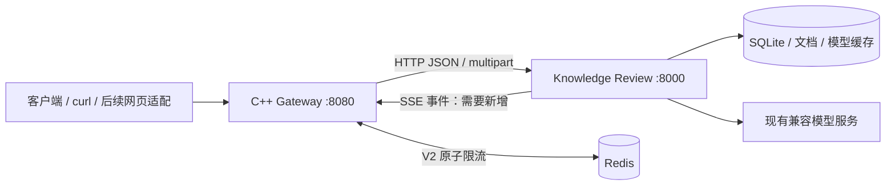

# C++ AI Gateway：现状核查与实施方案

初稿日期：2026-10-15；状态更新：2026-10-20。M0、M1、M2.1、M2.2与M2.3.1—M2.3.3核心范围已完成对应验收。M2.3.3将8个后台202入口及标题纳入Python实际工作槽，增加受Key保护的/agent-metrics；已同步独立Python项目。普通/ASan同批103项、Python相关255项、工具4项、真实隔离与容器同12组治理检查通过。准确命令/范围见[README](README.md)、[治理说明](docs/JOB_GOVERNANCE.md)及[evidence/m233-verification-20261020.json](evidence/m233-verification-20261020.json)。真实模型/完整embedding-RAG部署未验收；分布式并发/V3未实现，不承诺强杀阻塞或供应商远端停算。后文调查/旧阶段快照不代表当前缺少这些已交付能力。

## 1. 调查范围与结论

本节及第2、3节的“现有/缺少”是 M0 调查快照。M1.3 新增范围、实际源码和验证边界以 README 的 M1.3 节为准，不能再把下文当成更新后的逐文件盘点。

当前 gateway 工作区只有项目说明，`sources/` 为空。通过已有聊天定位到实际应用 **`E:\agentic project\knowledge-review`**，随后直接阅读源代码。聊天中的历史功能与测试成绩没有被当作当前验证结果。

调查基于 `learning-loop-mvp` 的**当前工作区**，其 HEAD 为 `d86372e5e9c41fc372de22a4ebfd5327e72faf20`。存在尚未提交的修改，包括 PDF 相关代码；因此单独检出这个提交不能复现本次调查的全部功能。没有修改该项目、读取业务数据库、读取 `.env` 或调用真实模型。

**当前路线：C++20 + Boost.Beast/Asio + CMake + Boost.Redis。** M2.1已将依赖基线升级到官方Boost1.88.0并在Ubuntu编译、运行和内存检查通过；M1初期采用系统Boost1.83的记录保留为历史。用户允许考虑 Drogon 以外的实现，选择原因见第 6 节。

关键现状：

- 已有 FastAPI HTTP 后端，无需另写一套 Python HTTP 服务。
- HTTP 问答已调用真实 Agent Loop，既有临时问答，也有持久会话。
- 当前问答、Agent 决策及最终结构化生成均采用完整响应方式，没有现成 SSE。
- 当前为本地单用户应用；有资料范围、版本和引用资格检查，没有用户登录、API Key 或跨用户资源隔离。
- PDF、会话历史、练习、评分、计划等都已有实现，应通过网关转发复用。

完整显式路由与请求模型见 [API 调查快照](<C:/Users/mamahorse/.codex/.chatgpt-projects/g-p-6ad08dfdf08c8191a4ab034424278e78/evidence/knowledge-review-api.json>)：`web_app.py` 69 条、`retrieval_review_app.py` 6 条，共 75 条；另有静态资源挂载，框架自动生成的路由不计入此数。快照保存了 36 个相关文件的 SHA-256，以及 29 个请求模型声明。

### 1.1 后端结构、依赖与入口

| 现有部分 | 实际职责与证据 |
| --- | --- |
| HTTP 与网页 | [web_app.py:415](<E:/agentic project/knowledge-review/web_app.py:415>) `create_app()` 创建 FastAPI、注册业务路由、挂载 `/static`，使用 Jinja2 渲染主页；文件末尾 `app = create_app()`。 |
| 启动 | [web_app.py:1261](<E:/agentic project/knowledge-review/web_app.py:1261>) `__main__` 用 Uvicorn 监听 `127.0.0.1:8765`；容器需要改启动参数为 `0.0.0.0:8000`，无需修改这个默认入口。 |
| CLI | [main.py:12](<E:/agentic project/knowledge-review/main.py:12>) `main()` 提供预览、检索、问答和 Agent 等模式，不是网关应调用的服务入口。 |
| Agent | [agent_loop.py:83](<E:/agentic project/knowledge-review/agent_loop.py:83>) `run_agent()` 使用同步 OpenAI 兼容 SDK，循环选择、执行工具，再调用最终回答阶段。默认工具调用预算为 4，可配置上限受 `MAX_TOOL_CALLS = 6` 约束。 |
| 最终生成 | [model_client.py:43](<E:/agentic project/knowledge-review/model_client.py:43>) `answer_question()` 负责上下文预算、结构化结果与引用校验；[structured_output.py:42](<E:/agentic project/knowledge-review/structured_output.py:42>) `request_structured()` 保留原生结构化输出及工具结果提交兼容路径。 |
| RAG 与工具 | [knowledge_tools.py](<E:/agentic project/knowledge-review/knowledge_tools.py>) `KnowledgeTools` 提供按需搜索和资料读取，接通向量/混合检索；[conversation_memory.py](<E:/agentic project/knowledge-review/conversation_memory.py>) 提供独立的历史工具。不得在网关强制每次提问先检索。 |
| 文档 | [document_model.py](<E:/agentic project/knowledge-review/document_model.py>) 的 `Document/ContentBlock/Asset`、[sources.py](<E:/agentic project/knowledge-review/sources.py>) 的 `Source`，承载 Markdown/PDF 与版本化来源；[pdf_parser.py:94](<E:/agentic project/knowledge-review/pdf_parser.py:94>) `parse_pdf()` 默认使用 PyMuPDF。 |
| 学习业务 | [practice_service.py](<E:/agentic project/knowledge-review/practice_service.py>) `start_practice()/grade_pending_answer()`、[learning_service.py](<E:/agentic project/knowledge-review/learning_service.py>) `enroll_question()/start_review()/correct_grade()`，以及 [review_scheduler.py](<E:/agentic project/knowledge-review/review_scheduler.py>) 的 FSRS 适配。 |
| 清单与路线 | [web_app.py:527](<E:/agentic project/knowledge-review/web_app.py:527>) `create_outline()` 和后续 grouping/routes 路由以 202 接受后台工作，使用 `BackgroundTasks`；与同步返回的问答不是同一生命周期。 |

依赖以声明文件为准：[requirements.txt](<E:/agentic project/knowledge-review/requirements.txt>) 包含 OpenAI SDK 2.x、FastAPI、Uvicorn、Pydantic 2.x、dotenv、Jinja2、multipart、markdown-it-py、FSRS 6.3.2，并包含 PDF 依赖文件；[requirements-local.txt](<E:/agentic project/knowledge-review/requirements-local.txt>) 额外引入 sentence-transformers 5.x 与 sentencepiece；[requirements-pdf.txt](<E:/agentic project/knowledge-review/requirements-pdf.txt>) 指定 PyMuPDF；[requirements-docling.txt](<E:/agentic project/knowledge-review/requirements-docling.txt>) 是可选 Docling 依赖。容器应安装 `requirements-local.txt`，仅基础依赖不能保证真正搜索可用。

现有 `.venv` 本次执行 `python --version` 得到 **Python 3.13.13**。这不等于依赖完整性或 Linux 兼容性已经通过；容器 Python 版本以构建及测试结果锁定。

### 1.2 已实现的问答、会话和流式边界

实际调用链：

```text
POST /api/ask
  → web_app.create_app 内的 ask()
  → generate_answer()
  → KnowledgeTools + run_agent()
  → OpenAI.chat.completions.create() 决定工具
  → 程序执行搜索/读取等工具
  → answer_question() → request_structured()
  → 校验预算、资料版本、引用 → 完整 JSON

POST /api/conversations/{identity}/turns
  → submit_turn() → execute_turn()
  → generation_lock / recover / begin
  → build_context() → generate_answer()
  → finish 或 fail → public_turn()
```

证据：[web_app.py:844](<E:/agentic project/knowledge-review/web_app.py:844>) `generate_answer()`、[web_app.py:997](<E:/agentic project/knowledge-review/web_app.py:997>) `execute_turn()`、[agent_loop.py:166](<E:/agentic project/knowledge-review/agent_loop.py:166>) SDK 调用，以及 [model_client.py:127](<E:/agentic project/knowledge-review/model_client.py:127>) 最终生成。

当前 HTTP 问答处理函数为普通 `def`，FastAPI 可以在线程池执行它们；这不会自动变成 SSE，也不保证断开 HTTP 就停止同步模型请求。对当前应用 Python 代码检索 `StreamingResponse`、`EventSourceResponse`、`text/event-stream`、`stream=True` 没有找到实现；浏览器 [app.js:31](<E:/agentic project/knowledge-review/web/static/app.js:31>) 使用 `fetch()` 后等待 `response.json()`。

**业务失败与 HTTP 错误要区分。** `execute_turn()` 捕获生成失败，调用 `ConversationStore.fail()`，随后返回 `public_turn()`；所以可能得到 **HTTP 200 + `status: "failed"`**。一次性 `/api/ask` 的模型异常则由 `generate_answer()` 转为 502。网关应保留已有正文及 HTTP 状态，不擅自统一改写成功/失败契约。

### 1.3 认证、资料权限与持久化

在已检查的应用路由、请求模型和中间件中，未发现 API Key、Bearer、登录会话、用户依赖或资源 owner 检查。[web_app.py:415](<E:/agentic project/knowledge-review/web_app.py:415>) `create_app()` 创建的是共享本地应用。

已有的“权限”主要是**资料范围与证据资格**：[web_app.py:823](<E:/agentic project/knowledge-review/web_app.py:823>) `resolve_scope()` 校验所选文档、焦点版本、行号；`guard_documents()` 复查资料变化；[conversation_store.py:289](<E:/agentic project/knowledge-review/conversation_store.py:289>) `finish()` 用 attempt、资料 revision 和记忆依赖防止迟到结果发布。这些检查应留在 Python。多个网关 Key 仍只能代表访问同一个用户空间，不能声称已经多租户隔离。

| 现有数据 | 保存方式与容器要求 |
| --- | --- |
| 上传资料 | [web_app.py:47](<E:/agentic project/knowledge-review/web_app.py:47>) 默认 `.data/notes/<uuid>/`。`DocumentCatalog.import_note()` 保存原文件；PDF 另保存 `document.json` 解析快照，替换版本可保存于 `versions/`。应挂载整个 `.data`。 |
| 资料库、练习、计划、清单与路线 | [practice_store.py:19](<E:/agentic project/knowledge-review/practice_store.py:19>) 默认 `.data/practice.sqlite3`；`LearningStore` 继承 `PracticeStore`，`LibraryStore` 使用同一存储。不是每个业务一个独立数据库。 |
| 聊天 | [conversation_store.py:26](<E:/agentic project/knowledge-review/conversation_store.py:26>) `ConversationStore` 保存 conversations、turns、messages、summaries 等；`create_app()` 默认使用 `.data/conversations.sqlite3`。原话、结构化结果与摘要分存。 |
| 文档向量 | [vector_index.py:14](<E:/agentic project/knowledge-review/vector_index.py:14>) 默认 `.data/embeddings.sqlite3`，网页将其定位到 practice DB 的相邻目录；包含资料版本与模型配置身份。 |
| 本地模型 | [embeddings.py:14](<E:/agentic project/knowledge-review/embeddings.py:14>) `.models/`；`LocalEmbedder` 默认 `local_files_only=True`。模型必须显式准备，不能把目录存在当成模型已就绪。 |
| 并发与跨库事务 | [conversation_store.py:89](<E:/agentic project/knowledge-review/conversation_store.py:89>) `generation_lock()` 已区分 Windows `msvcrt` 和 POSIX `fcntl`；[practice_store.py:77](<E:/agentic project/knowledge-review/practice_store.py:77>) 等连接使用 SQLite `ATTACH`。锁文件和相邻数据库也要保留在同一数据卷中。 |

**迁移风险需要实测：** [sources.py:51](<E:/agentic project/knowledge-review/sources.py:51>) Markdown `source_id` 和 `source_from_document()` 的 PDF 身份都包含解析后的绝对路径；从 Windows 迁到 `/app` 会改变身份。旧题目保存快照，不能据此推断所有旧聊天、当前文档引用和记忆资格都会自动兼容。V1 先使用独立容器数据与公开测试资料；原数据库先做一致性备份，再在副本中验证历史恢复、版本检查、PDF 资源和索引重建。不要把原 `.data` 直接作为首次试验的写卷。

### 1.4 测试与部署现状

现有 35 个 `test_*.py` 文件使用 unittest；例如 [test_web_app.py:15](<E:/agentic project/knowledge-review/test_web_app.py:15>) `WebWorkspaceTests` 用 FastAPI `TestClient` 和受控 Agent 验证 HTTP，[test_conversations.py:118](<E:/agentic project/knowledge-review/test_conversations.py:118>) 覆盖失败与幂等重试，[test_learning.py](<E:/agentic project/knowledge-review/test_learning.py>) 覆盖评分和复习，[test_pdf_documents.py](<E:/agentic project/knowledge-review/test_pdf_documents.py>) 覆盖 PDF 相关流程。这是测试代码存在的证据，**本轮没有运行这些测试，不引用历史通过数作为当前成绩**。

本次未发现项目级 Dockerfile、Compose 或已接通的网关部署配置。`app = create_app()` 导入时会初始化存储，不能为调查路由而直接导入网页模块。本轮采用 AST 解析，避免调查产生数据库写入。

## 2. 职责边界与整体流程



| Gateway 负责 | Knowledge Review 负责 |
| --- | --- |
| 固定上游与显式路由、Key 鉴权、HTTP 头处理、字节转发 | 请求 Schema、资料和用户输入校验、既有业务响应 |
| 异步 SSE 传输、连接超时、背压、网关资源回收 | Agent、RAG、结构化输出、引用校验、会话和学习事务 |
| V2 请求限流、请求级并发准入、有界排队、错误指标 | V2 业务任务取消、后台任务状态与完成确认 |
| liveness/readiness 与脱敏访问日志 | Python 存储、模型、资料版本与业务诊断 |

正常顺序：解析请求头和大小限制 → 精确匹配方法/路径 → API Key → 分类别 → V2 Redis 限流 → V2 并发/排队准入 → 固定上游调用 → 按响应模式转发 → 统一结束和释放资源。

V1 只有一个 `http://agent:8000` 上游。客户端不能指定代理目标，路径和 query 原样保留；不引入服务发现、负载均衡、熔断、Token 计费、JWT 或监控平台。

## 3. 首批真实 API 与契约

网关与 Python 使用相同 `/api/...` 路径，不添加无意义的重写前缀。表中“直接接入”指 **Python 已具备接口，可经网关透传**，不表示网关现已实现。

### 3.1 首批接入清单

| 方法与路径 | 请求 / 响应要点 | 接入方式、类别与源码 |
| --- | --- | --- |
| `GET /api/documents?collection_id=root` | 返回 `[{id,name,collection_id}]` | 直接；轻请求；`web_app.documents()`，443 行。 |
| `GET /api/documents/{document_id}` | 返回 `id/name/source_id/revision/lines/html/format/blocks/assets/...`，PDF 还有解析状态 | 直接；读取；`read_document()`，696 行。 |
| `POST /api/documents?collection_id=root` | multipart 重复字段 **`files`**；201 返回导入文档数组 | 直接；导入类；`import_documents()`，747 行。网关保留 multipart boundary。 |
| `GET /api/documents/{document_id}/assets/{asset_id}?source_id=...` | 成功返回 PNG；旧版本可 409 | 直接；资源读取；`read_asset()`，736 行。 |
| `POST /api/ask` | `AskRequest` → 完整回答对象 | 直接；耗时模型请求；`ask()`，912 行；不保存为持久会话轮次。 |
| `POST /api/conversations` | `{"title":"网关学习"}` → 201 会话对象 | 直接；轻请求；`create_conversation()`，955 行。 |
| `GET /api/conversations?archived=false` | 会话对象列表 | 直接；轻请求；`list_conversations()`，927 行。 |
| `GET /api/conversations/{identity}/messages?after_seq=0&limit=100` | `{conversation,turns,next_cursor,summary}`；limit 1–200 | 直接；`conversation_messages()`，971 行。可能安排后台自动标题，不能假定 GET 永远不调用模型。 |
| `POST /api/conversations/{identity}/turns` | `TurnRequest` → `public_turn()` | 直接；耗时模型请求；`submit_turn()`，1045 行。 |
| `POST /api/conversations/{identity}/turns/{turn_id}/retry` | 可传 `response_language/retrieval_mode`，返回该轮次 | 直接；耗时模型请求；`retry_turn()`，1054 行。 |
| `POST /api/conversations/{identity}/turns/{turn_id}/skip` | 无业务正文；返回轮次 | 直接；轻请求；`skip_turn()`，1067 行。 |
| `POST /api/practice` | `PracticeStartRequest` → 201 练习会话 | 直接；耗时模型请求；`create_practice()`，1119 行。 |
| `GET /api/practice/{session_id}` | `public_session()` | 直接；轻请求；`read_practice()`，1112 行。 |
| `POST /api/practice/{session_id}/answers` | `{answer,response_language?,assistance?}`；保存答案后评分 | 直接；耗时模型请求；`submit_practice_answer()`，1146 行。失败可能已保存答案，禁止自动重发。 |
| `POST /api/practice/{session_id}/grade` | 可选 `{response_language}`；只重试评分 | 直接；耗时模型请求；`retry_practice_grade()`，1161 行。 |
| `POST /api/practice/{session_id}/enroll` | `{question_id,unit_id?,response_language?,collection_id?}` → `{item_id}` | 直接；主动加入计划；`enroll()`，1213 行。 |
| `GET /api/learning?collection_id=root` | `LearningStore.list_plan()` 返回的计划对象 | 直接；轻请求；`learning_plan()`，1209 行。 |
| `POST /api/learning/{item_id}/review` | `{mode:"variant"或"original",response_language?}` | 直接；按最坏情况归为耗时模型请求；`review()`，1221 行。 |

上表定义均来自 [web_app.py](<E:/agentic project/knowledge-review/web_app.py>)；请求模型的类型、默认值、约束可逐项查 [AST 快照](<C:/Users/mamahorse/.codex/.chatgpt-projects/g-p-6ad08dfdf08c8191a4ab034424278e78/evidence/knowledge-review-api.json>)。网关不重写这些业务 Schema。

其他已有接口：集合移动/删除、文档替换/移除/重解析、聊天归档/恢复/删除、历史引用、讨论出题、清单提取/归组/原文复查/路线审核、评分修订和检索评测审核。完整路径都在快照。首轮采用表中的显式白名单，其他路径有业务需要再加入；不把所有 `/api/*` 直接开放。

**后台任务例外：** `/api/collections/{identity}/outlines`、`/api/outlines/{identity}/grouping`、`/api/outlines/{identity}/routes` 等返回 202 后仍执行模型任务。首批白名单暂不包含它们，后续接入必须基于 job 生命周期计数，不能在收到 202 时就释放“Agent 任务名额”。会话读取触发的自动标题也要在 Python 工作队列内有界；网关 HTTP 并发上限无法独自覆盖它。

### 3.2 问答与会话示例

先调用文档列表和详情，用响应里的真实 `id` 与 `source_id` 替换下例占位符。不要凭空固定 source_id。

```json
{
  "document_ids": ["<详情返回的id>"],
  "focus_document_id": "<同一个id>",
  "focus_source_id": "<详情返回的source_id>",
  "question": "解释这份资料的核心观点",
  "strict": false,
  "response_language": "zh",
  "retrieval_mode": "hybrid"
}
```

此对象适用于 `/api/ask`。`document_ids` 必须包含 1–20 个文档，question 长度为 1–4000；`line_start/line_end` 可同时省略，填写时必须成对并通过版本/范围检查。中文/英语枚举沿用 `ResponseLanguage`。API 不传 retrieval_mode 时默认 `dense`，网页已显式选择 `hybrid`，网关不改变默认值。证据：[web_app.py:175](<E:/agentic project/knowledge-review/web_app.py:175>) `AskRequest` 与 `resolve_scope()`。

持久会话接口在上述对象中增加 `"request_id":"gw-demo-001"`。该字段是**业务幂等标识**，与网关的 `X-Request-ID` 链路标识分开。`ConversationStore.begin()` 通过 `(conversation_id, request_id)` 检查重复和载荷冲突；同一标识、不同内容会冲突，已完成轮次可以复用原结果。网关不自动重试这些 POST。证据：[web_app.py:196](<E:/agentic project/knowledge-review/web_app.py:196>) `TurnRequest`、[conversation_store.py:238](<E:/agentic project/knowledge-review/conversation_store.py:238>) `begin()`。

一次性问答返回 `coverage/coverage_note/blocks/steps/stop_reason/focus_context/history_references/retrieval`；每个 block 有 `kind/text/citations`。持久会话返回 `id/seq/request_id/status/error/messages/context/memory_valid`，助手消息的 `result` 承载前述回答对象。证据：`generate_answer()` 与 [web_app.py:924](<E:/agentic project/knowledge-review/web_app.py:924>) `public_turn()`。练习响应由 [practice_store.py:358](<E:/agentic project/knowledge-review/practice_store.py:358>) `public_session()` 生成，包括会话状态、questions、真实作答、反馈、引用和复习信息；不转换成另一个“通用聊天”格式。

### 3.3 需要新增或少量适配的接口

| 新增项 | 原因与范围 |
| --- | --- |
| Python `GET /healthz` | 当前没有专门健康端点。只证明进程与配置初始化可用，不发送模型请求；完整模型/资料检查另做就绪诊断。 |
| Python `POST /api/conversations/{identity}/turns/stream` | 新增 `TurnRequest` 对应的 SSE 入口，复用原轮次流程；不是改掉已有 JSON 接口。 |
| Gateway `GET /livez`、`GET /readyz` | live 不依赖 Redis/Agent；ready 异步检查 Agent，V2 启用限流后也检查 Redis。正常与不可用分别 200/503。 |
| Python 事件与取消钩子 | 在 `execute_turn()/generate_answer()/run_agent()` 的阶段边界增加可选参数，默认无副作用，详见第 5 节。 |
| 既有网页通过 Gateway 访问 | `app.js` 的请求帮助函数需要传 Key；新增流式请求使用 fetch 读取流。当前网页不会自动带 Key，不能直接宣称整套网页已经接通。 |

## 4. 网关模块与 HTTP 行为

以下是**目标目录规划**。2026-10-16 已按 M1.1/M1.2 实际需要创建 CMake、main/gateway/policy 和测试，没有生成其余空模块；实际文件以 README 为准。按里程碑逐个创建，避免先堆框架。

```text
ai-gateway/                   # 独立仓库，不放进 knowledge-review 内
  CMakeLists.txt
  README.md
  src/
    main.cpp                  # 配置、io_context、监听、信号和退出
    listener.hpp/.cpp         # accept 和连接总数上限
    proxy_session.hpp/.cpp    # 一次下游请求对应上游请求及传输状态
    routes.hpp/.cpp           # method/path 白名单、类别和大小/超时策略
    auth.hpp/.cpp             # X-API-Key 验证，返回非秘密的 key_id
    admission.hpp/.cpp        # V2 名额、FIFO 有界队列和 Permit
    redis_limiter.hpp/.cpp    # V2 Boost.Redis 异步 EVAL
  scripts/rate_limit.lua      # V2
  tests/
    fake_agent.py             # 延迟分块、断流和错误注入
    test_proxy.py             # 黑盒 HTTP/SSE/故障测试
  deploy/
    Dockerfile.gateway
    Dockerfile.agent          # 集成构建配方，Python业务继续独立维护
    compose.yaml
    .env.example
```

核心只保留 `Listener`、`ProxySession`，V2 再引入 `AdmissionController/Permit` 与 `RedisLimiter`；路由配置可以是普通结构体和函数，不需要接口继承树、插件注册、策略工厂或 DI 容器。

初期一个 `io_context`、一个运行线程；普通请求和 SSE 使用同一个异步网络模型。一连接一次在途请求，V1 不做 HTTP pipelining；SSE 使用独占连接。后续用两个 I/O 线程学习 `strand`，同一 Session 的状态和定时器只能在其 strand 内修改。网络循环里不进行同步 HTTP、同步 Redis、磁盘扫描或等待 `future.get()`。

**必须落实的 HTTP 规则：**

- 仅代理固定上游，保留方法、路径、query、状态和正文；业务 Key 用 `X-API-Key`，缺失/无效返回 401，密钥未配置则启动失败。
- 删除客户端 Key、伪造的身份头，以及 hop-by-hop 头；也删除 `Connection` 所列的动态头名。重设 Host，重新生成消息 framing，不能复制上游 `Transfer-Encoding` 或过期的 `Content-Length`。
- 普通 JSON 设置有界正文；multipart 上传保留原始 boundary，不转为 JSON、不解析 PDF。先验证头部，再按路由读取正文，避免未鉴权就缓冲大文件。
- 当前后端每批最多 20 文件，Markdown 每份 2 MiB、PDF 每份 20 MiB。网关上传整体上限初定 416 MiB，为最大 PDF 批次留 multipart 余量；**上传要采用固定块转发，不能每连接分配 416 MiB 字符串**。首个里程碑先验小文件，批量上限在 M1.2 专项验收。证据：`MAX_SCOPE/MAX_UPLOAD_BYTES`、`DocumentCatalog.prepare_import()`、`pdf_parser.MAX_PDF_BYTES`。
- POST 默认不重试，尤其提交答案可能已写库。客户端按业务重试接口恢复，不把 HTTP 超时等同业务事务回滚。
- 初期面向 curl/API 客户端验收；网页接入时从内存中的 Key 输入统一加头，不把 Key 写进静态页面、URL、日志或镜像。统一同源使用，跨域规则有实际需要再加。
- 业务路径都鉴权；健康探针返回最小状态且不暴露配置。`/retrieval-review`、检索审核接口和框架 Schema 不默认开放。

## 5. Python SSE 的最小适配方案

### 5.1 V1 的流式语义

V1 提供**真实执行进度 SSE + 校验后最终结果**。工具开始/完成、进入最终生成等事件发生时立即发送；最终回答仍沿用完整结构化解析、引用校验与落库。**逐 token 生成不是现有能力，也不作为 V1 的已交付承诺。** 不能把完整 JSON 事后切成小段，称为模型流式输出。

新接口建议使用 POST，并沿用 `TurnRequest`。浏览器通过 fetch 传 Key、JSON 正文，再用流式 reader 解析 SSE；原生 EventSource 无法直接承载这套 POST 正文和自定义鉴权头。

约定事件：

| event | data 内容与发送时机 |
| --- | --- |
| `meta` | 业务 request_id、turn_id、链路 ID；获得轮次后发送。 |
| `progress` | `phase`、工具名及开始/完成状态；不发送隐藏思维链。 |
| `result` | `{"turn": <原 public_turn()>}`；只在校验并成功保存后发送一次。 |
| `error` | 安全的 code/message/turn_id；对应业务失败，不回显 SDK 异常全文。 |
| `done` | completed/failed/cancelled；连接仍可写时终态发送一次。 |

编码为 `event: ...\ndata: <单行JSON>\n\n`；每 15 秒可由 Python 发送注释心跳 `: ping\n\n`。同一业务重复请求已完成时，直接发送原 result/done，不重跑工具。SSE 不提供断线事件日志重放；恢复应读取既有 `/messages` 或使用已有 retry 接口。

### 5.2 改动位置及原因

1. 在原 `create_app()` 内增加 `/turns/stream`，复用闭包里的 `execute_turn()`。将其中轮次执行部分加上可选 `event_sink`，不另外构建一个重复管理 SQLite 和 Agent 的应用。
2. `generate_answer()`、`run_agent()` 增加可选事件回调。只在程序已确认的阶段边界通知；原 JSON 路径参数默认为空，保持当前工具选择、预算和最终回答路径。
3. 新建一个小的 SSE 编码/桥接模块：异步生成器负责网络输出，现有同步业务在**有上限的线程执行器**运行。使用线程安全的有界事件桥，限制事件数、单事件和累计字节；不能直接跨线程操作 `asyncio.Queue`，也不能丢弃 result/done。
4. 流开始前验证 Key 所需网关策略、Schema、资料范围，并等待后台执行器完成短暂的轮次准入。格式、资料或会话冲突应尽可能在提交 SSE 头部前返回现有 4xx；流中发生的业务失败通过 error/done 表达。
5. 默认事件桥预算先设 32 个普通事件/256 KiB；最终 result 沿用独立的有界 JSON 输出预算，建议 4 MiB。达到上限明确失败，不截断结构化答案，不悄悄丢事件；较大正文的兼容边界要用真实现有样例校准。

这样做改变的是**传输可见性**：客户端在执行期间收到进度，而不是一直等待完整 JSON；资料引用、记忆、幂等、练习数据库和模型服务保持原有职责。最终结果必须在 `finish()` 提交成功后发布，避免用户看到后来被版本检查撤销的“成功答案”。

### 5.3 取消的真实边界

取消 Python `run_in_threadpool()` 的等待任务，不能强制终止已经运行的同步 SDK 调用。[model_client.py:27](<E:/agentic project/knowledge-review/model_client.py:27>) `model_settings()` 目前设置单次 SDK timeout 为 30 秒，未显式限制整个 Agent 轮次截止时间；SDK 重试也需要在实施时明确配置。

- **V1：**网关在超时/错误时关闭自身连接、取消定时器并回收缓冲；Python 工作可能继续到当前模型调用结束。SSE 线程执行器必须有界，不能用关闭网关连接来宣称已经取消业务。
- **V2：**贯通取消标识，在工具前后、模型前后、保存前检查；断开 SSE 触发 Python 取消，迟到结果不能发布。当前同步路径可先实现协作取消，但完整任务取消验收必须包括 SSE 模型传输层可取消：使用与原服务兼容的异步 SDK/传输路径，并传播任务取消和总截止时间，及时关闭模型 HTTP 流。
- 不要求一开始重写所有业务为 async；优先局限于流式入口和模型传输接缝。CPU 推理/解析等工作仍需协作检查。关闭模型连接不能证明外部供应商立即停止计算或计费。

**如果只完成同步调用后的协作检查，就记录为 V2 部分完成，不能勾选“完整取消链通过”。**

## 6. SSE 代理可行性与选型

### 6.1 已核实的 Drogon 行为

本次阅读了 Drogon **v1.9.14** 的公开头文件和实现：

- [HttpClient.h](https://github.com/drogonframework/drogon/blob/v1.9.14/lib/inc/drogon/HttpClient.h) 的 `sendRequest()` 接收完整响应回调，没有公开的逐响应正文块回调。
- [HttpClientImpl.cc](https://github.com/drogonframework/drogon/blob/v1.9.14/lib/src/HttpClientImpl.cc) 在 `onRecvMessage()` 中调用解析器，`gotAll()` 后才进入 `handleResponse()`。
- [HttpResponseParser.cc](https://github.com/drogonframework/drogon/blob/v1.9.14/lib/src/HttpResponseParser.cc) 的 `kExpectChunkBody` 分支将块内容追加到 `responsePtr_->bodyPtr_`，最终空块后才标记完成。

结论：**该版本普通 `HttpClient::sendRequest()` 异步的是等待过程，完整响应回调不适合消费持续 SSE。** 长流可能一直等不到业务回调，直到结束或超时。给回调套协程也不会改变这个缓冲行为。这是源码核查结论，本轮没有编译 Drogon 做网络实测。

另一方面，[HttpResponse.h](https://github.com/drogonframework/drogon/blob/v1.9.14/lib/inc/drogon/HttpResponse.h) 提供 `newAsyncStreamResponse()`、`ResponseStream::send()/close()`，所以 **Drogon 可以向客户端异步发送流**。其中 `ResponseStreamPtr` 是 `unique_ptr`；`send()` 返回值不代表对端已经消费了数据，不能据此推导严格背压。上游读取和下游写出必须分别验证。

### 6.2 替代方案比较与决定

| 方案 | 可行点 | 代价与本项目决定 |
| --- | --- | --- |
| Drogon 服务端 + Beast 异步上游 | Beast 可以先读头、再固定缓冲增量读取；Drogon 写 SSE | 要协调 Asio/Trantor 两套执行上下文、跨线程对象和下游背压；可行替代，但不作为本项目首选。 |
| Drogon 服务端 + libcurl multi 上游 | multi 接口可用写回调逐块接收，socket/timer 接入事件循环 | 需要明确 multi 的 fd/timer 集成、暂停恢复、取消和 Trantor 缓冲上限；不能用每请求一个阻塞 curl 线程冒充非阻塞代理。保留为另一条替代路线。 |
| **Beast/Asio 统一两端** | HTTP 解析、流式读取、异步写完成和取消都在同一执行模型中 | 路由与 Session 要自行写少量代码，换来直接观察网络状态与背压；**推荐方案**。 |
| 自写 epoll + HTTP 解析器 | 学习底层原理 | HTTP framing 和异常处理投入过大；不作为本项目主线。 |

保留 Drogon 时，libcurl 的事件式替代路线可参考官方 [multi interface](https://curl.se/libcurl/c/libcurl-multi.html) 的 multi_socket 和 socket/timer 回调说明；它仍需要应用负责取消、资源清理与背压，不能直接替换成一个阻塞 easy 调用。

Beast 官方 [Parser Stream Operations](https://www.boost.org/doc/libs/latest/libs/beast/doc/html/beast/using_http/parser_stream_operations.html) 明确区分读取完整消息、只读头和 `async_read_some()` 增量读取；[Chunked Encoding](https://www.boost.org/doc/libs/1_88_0/libs/beast/doc/html/beast/using_http/chunked_encoding.html) 提供 HTTP chunk 解析和序列化辅助。选择它能避开完整响应回调这一限制，**仍必须由 M1.2 黑盒测试证明实际转发没有缓冲**。

初始构建候选为 Boost 1.88.0、C++20；2026-10-16 的 M1.1 实际采用 Ubuntu 24.04 系统 Boost 1.83，完成了 Beast/Asio 编译和运行验收，并在进程中观察到 eventpoll 描述符。V2 的 [Boost.Redis](https://www.boost.org/doc/libs/1_88_0/libs/redis/doc/html/index.html) 复用 Asio 异步模型，引入前需要升级并重新验证 Boost 基线，不额外引入 Redis 事件循环。Windows 原型运行不能代替 Linux epoll 验证。[Asio 平台配置说明](https://www.boost.org/doc/libs/1_88_0/doc/html/boost_asio/using.html)

### 6.3 逐块转发算法与背压

```text
读取完整上游响应头
  ├─ 非成功状态：有界读取错误正文，透传状态和正文
  ├─ SSE 路由却不是 text/event-stream：提交下游头前返回 502
  └─ SSE：发送下游响应头
        → response_parser<buffer_body> + 16 KiB scratch
        → async_read_some 得到正文有效字节
        → 用 HTTP chunk 写给下游，并等待异步写完成
        → 写完成后才发起下一次上游读取
        → 正常 EOF/完整结束：发送最终 chunk，统一 finish
```

每次读取都重置 buffer_body 的 data/size，按实际被填充的字节数转发；正确处理 `need_buffer`、零正文进展、解析失败与提前 EOF。HTTP 的 chunk 边界、TCP 包边界和 SSE 事件边界并不相等。网关不按“每次读取一个事件”处理，不逐块解码 UTF-8，不重新切 SSE；保留完整正文的字节顺序即可。下游 chunk 由网关重新编码，上游 framing 不作为正文转发。

核心限制是一读一写串行推进，不建立无界发送队列。Beast 解析用的 dynamic buffer 和响应头也设最大值；不能只限制 scratch 却让另一个输入缓冲无限增长。先保证固定内存传输，再考虑双缓冲优化。下游长期不可写由写超时终止，不无限保留上游任务。

为 SSE 请求上游设置 `Accept-Encoding: identity`，避免代理压缩缓冲；响应使用 `Content-Type: text/event-stream` 和 `Cache-Control: no-cache`。若前面实际增加 Nginx，另配置关闭代理缓冲；当前架构不需要新增 Nginx。

### 6.4 生命周期、超时与断流

`ProxySession` 拥有两端 socket/stream、解析器、缓冲、序列化器、定时器及 V2 Permit。初始状态：Reading → Admitted → Connecting → Headers → Relaying → Closing → Finished。所有结束路径汇入幂等 `finish(reason)`。

- 异步操作期间持有 Session，避免捕获会过期的栈引用或裸 `this`；定时器回调可用 weak_ptr。不要让 Session 与回调长期互相强持有。
- C++20 协程的参数/帧持有 `shared_ptr<ProxySession>`，避免临时捕获型协程 lambda 的生命周期陷阱。buffer_body 指针与 chunk 序列的底层内存在写完成前保持有效。
- 终止时先标记状态，再取消定时器/解析/连接操作；处理 `operation_aborted` 的迟到完成；Permit 只释放一次。关闭 socket 后仍可能收到完成回调。
- SIGTERM 先停止 accept，给在途请求有限宽限期，随后取消并关闭；会话和 Redis 连接清理后再退出 io_context。

初始**可调验收参数**：连接 3 秒、轻请求总计 10 秒、模型 JSON 请求总计 180 秒、SSE 首个业务/心跳字节 10 秒、上游读空闲 45 秒、下游写 15 秒、SSE 总计 300 秒。请求头另设读取截止时间。心跳能延长读空闲时间，不能取消总截止时间。上传另设整体期限，不能套用轻请求 10 秒。

提交下游头部前，连接失败返回 502、截止超时返回 504；提交后无法再换成 504。**上游中途断流时立即异常终止下游，不伪造 result/done 或正常的流结束**。客户端必须以业务 done/result 判断完成，结合既有历史接口恢复。V2 才完善断连到 Python/模型传输的取消链。

## 7. V2：限流、并发与排队

### 7.1 Redis + Lua 原子限流

2026-10-16 M2.1原生实现已经落地，实际代码、短连接取舍、配置与验收边界见README和docs/RATE_LIMITING.md。以下保留设计推导；当前原生默认关闭、Compose默认开启，Docker引擎暂不可用导致新版容器验收待补。

先实现便于解释的固定窗口计数，不引入 Token 计费。Key 形如 `gw:rl:<key_id>:<request_class>`，不包含原始秘密 Key；窗口从首个获准请求建立。

Lua 一次完成：读取当前计数 → 达到上限则返回拒绝和剩余 TTL → 否则 INCR → 首次计数设置 PEXPIRE → 返回允许、剩余额度、TTL。检查和更新都在脚本内，避免分别执行 GET/INCR/EXPIRE 的竞态；处理异常无 TTL 状态并在测试中验证。固定窗口边界可能产生短时突发，接受这个算法限制，不称为平滑限流。[Redis Lua 原子执行说明](https://redis.io/docs/latest/develop/programmability/eval-intro/)

初期直接异步 EVAL 短脚本，暂不引入脚本缓存失效处理。每类单独配置额度，例如轻请求 120/min、模型请求 10/min，只是验收默认值。限流拒绝返回 429 和向上取整的 `Retry-After`；Redis 错误/短超时（初设 100ms）返回 503，不悄悄降为每进程本地计数。V2 readiness 也相应变为不可用。

两个网关实例连接同一个 Redis 时，**请求计数共享**。这不意味着本地并发名额也已经共享。Redis 运行时重启会重置纯缓存限流状态；V1/V2 接受这一边界，不把它称为持久配额系统。

### 7.2 类别、准入和容量

按精确的方法/路由配置分类，不靠路径是否包含 `agent` 判断。`ask/turns/stream/retry/practice/answers/grade/review` 等均是耗时请求；PDF 导入属于另一类昂贵工作；读取元数据单独限流。所有未知路由默认不代理。

单 Gateway 的模型请求初始上限 2，FIFO 等待最多 8 个，等待截止 2 秒；仅队列中的 JSON 请求允许排队，并另设总字节预算。普通读请求拥有独立连接/在途上限，示例 64；总连接上限 128。数字是可修改的学习基线，不能称为压测结论。

**M2.2实际实现更新（2026-10-19）：** 2个Permit、8个FIFO条目、4MiB排队JSON正文和2秒期限可配置，SSE的请求正文同为JSON并进入该共享队列。原生默认关闭准入，Compose默认开启；普通读取绕过模型名额，仍使用总连接128上限，未新增独立保留64条连接的策略。排队FIN明确视为撤回，不支持该阶段写半关闭后继续等响应；已开始代理的逻辑保留。细节及验证见并发说明，不能用原设计中的示例值声称已经实现额外保障。

`AdmissionController` 负责唯一的准入状态，`Permit` 是 move-only RAII 对象；队列项还拥有取消标识、等待计时器和有限正文。排队断连、超时、过载、执行失败都走同一清理路径；不为每个队列项启动线程，不持 mutex 做网络等待。队列满/排队到期返回 503 `GATEWAY_OVERLOADED`，与 Redis 的 429 区分。Redis 计数的是到达并通过 Key 验证的请求；通过限流后又被本地过载拒绝的请求仍消耗此次窗口额度，策略明确即可。

**名额释放语义：**请求级 Permit 可以在代理结束时释放，但若 Python 同步任务仍在运行，它不能证明实际 Agent 活动数下降。完整 V2 验收需要 Python 执行器持有自己的业务任务名额，直到工作真正结束；只取消等待该线程的协程不释放这个名额。Gateway 在途请求数与 Python 活动任务数分开统计。Python 执行器的待提交队列也必须有界，仅配置 ThreadPoolExecutor 的 max_workers 不足以限制排队。先保证单网关 + 单 Python 进程的边界；若以后增加多个 Gateway 且要求共享任务并发，需另加带过期租约/续约的分布式名额，当前不宣称具备。

后台 202 工作的治理留到同一 V2 的独立子阶段：按 job_id 从创建到完成/暂停/取消持有名额，Python 的内部标题等工作也进入有界执行器。不得只给 HTTP handler 加 semaphore 就声称覆盖所有 Agent 任务。

**M2.3.2实际实现更新（2026-10-19）：** 模型请求完整正文后主动监听FIN/RST，FIN包括写半关闭均视为撤回；非模型GET保留原半关闭行为。Python已接入JSON/SSE绑定独立Token，异步httpx传输由工作线程拥有并在取消后等待关闭，保留同步SDK/业务函数；范围内禁用SDK重试。会话最终提交前检查，取消复用failed和原输入，实际Future退出才归还Python槽。范围外后台任务与不可取消底层阻塞尚无全局取消保障，不能证明供应商远端算力停止。源码/契约/验证见取消说明。

### 7.3 指标与日志

V1 使用 stdout 结构化日志：链路 ID、route 模板、类别、HTTP status、耗时、上下游字节、结束原因。V2 增加 active/queued、429/503、连接失败、超时、流中断、取消、Redis 错误与已观测的业务失败计数。不得记录原始 Key、Authorization、问题/答案、上传内容、完整 query 或 SDK 异常载荷。

HTTP 200 不作为业务成功率；现有 turn 的 `status=failed` 与 SSE error 单独统计。可以对已接入的有界 JSON 提取 status，但不为了指标缓冲完整 SSE。指标先提供受保护的简单 JSON 快照/日志，无需 Prometheus/Grafana。

**M2.3.1实际实现更新（2026-10-19）：** `GET /metrics`已提供沿用API Key鉴权的进程内JSON快照，独立于Redis/上游；健康与指标请求不计入业务请求统计。已观察HTTP状态、结束原因、连接、模型HTTP在途、Permit/FIFO及已识别的业务失败。JSON检查上限64KiB/深度16，SSE只保留有界行/事件，转发内容不变；无法判定不当作成功。网关在途/Permit归零不证明Python任务停止，字节计数沿用日志口径，不代表精确网络流量或客户端收到的字节。未提供Python实际后台任务指标，详情与复现方式见指标说明。

## 8. 里程碑、运行方式和验收门槛

| 里程碑 | 修改内容 | 运行与验收 | 尚未包含 |
| --- | --- | --- | --- |
| **M0，2026-10-15 完成** | 本计划、真实路由/请求模型快照、只读 AST 调查工具 | 重新运行调查工具；核对文件哈希与路径；见第 10 节历史结果 | 当时尚无 Gateway 运行功能 |
| **M1.1，2026-10-16 完成** | CMake、Listener/Session、live/ready、Key、19 类 JSON 路由、超时及日志；用可配置的既有 Python 接口做探针，未修改原后端 | Ubuntu 构建、23 项黑盒及同批 ASan/UBSan 检查、7 项真实后端隔离检查通过；具体记录见 README | SSE、Redis 治理、真实取消 |
| **M1.2，2026-10-16 完成** | 固定缓冲 SSE 代理和 multipart 上传，新增流式故障与时序测试 | 逐事件时序、中文跨块、读写/总期限、慢读、半关闭、断流、FD/线程恢复；32 MiB 合成上传、真实 Markdown/PDF 上传和超限头部检查；完整记录见 README | Python SSE 业务入口、模型 token streaming、完整 Python 取消、416 MiB 实际批量文档验收 |
| **M1.3，2026-10-16 核心完成** | Python 可选事件钩子、有界线程桥、`/turns/stream`；JSON旧接口保持；实际 Compose 配置 | 新增12项、相关旧回归80项；可控模型 HTTP 链路10项；Markdown/PDF/SQLite 11项；容器首次6项、替换恢复5项；详见 README | 真实模型/完整RAG容器验收、Redis限流、跨入口共享准入、完整取消、后台job治理 |
| **M2.1：原生及核心容器验收完成** | Boost1.88/Redis、Lua、normal/model/upload类别、429/503策略；修复镜像build阶段bzip2遗漏 | 同批61项普通及ASan/UBSan检查；原生双实例40到达放行7；TTL/超时/断线/已提交响应丢失不重放；真实Python隔离链路10项。10月18日另完成最新镜像、容器双实例40到达放行7/拒绝33、首次6项/替换恢复5项及Redis故障恢复；未重跑旧61项 | 任务级共享并发与排队、完整取消、完整真实模型/RAG部署 |
| **M2.2：本地并发与有界排队完成** | AdmissionController/RAII Permit、FIFO条数/正文预算/期限、Python7个JSON入口与SSE共享实际槽；支持已知M1.3升级 | 同批72项普通/ASan，包括11项准入、2执行+8FIFO、100次排队断连FD11→11；Python7新增+12SSE/80相关旧回归及工具4项；真实受控HTTP链路8项；容器新建/替换/再次启动恢复通过 | 全部后台202/标题治理、完整模型取消、指标接口 |
| **M2.3.1：基础指标完成** | 受保护的本地JSON快照、单次结束计数、有界JSON/SSE业务失败观察 | 同批87项普通/ASan；真实受控链路8项及容器同8项；双网关独立、重建计数归零、业务恢复、Redis停机指标可读；见`evidence/m231-verification-20261019.json` | 完整取消、后台202/标题治理、Python实际任务指标 |
| **M2.3.2：请求范围模型HTTP取消完成** | 模型JSON/SSE主动断连监测、Python请求Token与可取消HTTP、检查点及failed保存，真实Future完成后释放实际槽 | 同批94项普通/ASan、Python115项/工具4项；真实隔离与容器同9组取消/同8组指标；模型EOF/最终生成/超时/重复取消/持久化恢复 | 后台202/独立标题治理、Python实际任务指标；不强杀阻塞工具/承诺供应商停算 |
| **M2.3.3：后台任务治理核心完成** | 8个后台202入口/标题共享实际工作槽；原暂停继续；受保护Python工作快照 | 同批103项普通/ASan、Python255项/工具4项；真实与容器同12组治理；实际模型EOF、Agent崩溃恢复、最终槽/键归零、100次快照FD9→9；源码同步20文件 | 真实模型/完整RAG部署；分布式并发及V3 |

以下是 M0 制定的阶段验收命令约定；当前 M1.1 的准确构建目录和已执行检查见 README。这里的命令是 M0 约定；实际 M1.3 容器构建与检查见 deploy/README 和当前验收记录：

```sh
cmake -S . -B build -DCMAKE_BUILD_TYPE=Debug
cmake --build build -j2
ctest --test-dir build --output-on-failure
python3 -m unittest discover -s tests -v
docker compose -f deploy/compose.yaml config --quiet
docker compose -f deploy/compose.yaml up --build -d
```

SSE 测试不能只看浏览器出现文字：fake_agent 在 t=0/1/2 秒分别发送三个事件，在 t=3 秒结束；记录客户端接收时间，必须在上游结束前收到首事件，并保持中间事件顺序与延迟。使用原始流客户端逐字节接收或 curl `--no-buffer` 辅助观察，避免行缓冲影响判断；一次读取里包含多个事件也不应失败。

慢客户端测试让上游持续发送、下游缓慢读取：记录 Session 缓冲和进程 RSS，验证用户态缓冲有界，写超时有效。断流后不得产生完整 result/done。完成与取消循环至少 100 次，比较进程 FD、活动任务、队列项及线程数，设定可解释的回收容差。Linux 调试构建启用 ASan/UBSan 验证生命周期；多线程阶段再做针对性数据竞争检查。

V2 取消必须用**受控异步模型服务**验证：客户端断连后网关停止读取，Python观察取消、模型服务观察连接关闭，没有新工具/模型调用，没有迟到结果落库。分别测试“排队中”“工具边界”“模型正在读取”“最终保存前”；协作取消与传输中断分别报告时间，不能只测关闭浏览器标签页。外部真实供应商的停止计费不在这项程序保证内。

每完成一个里程碑，README 记录：实际新增文件和行为、为什么这样改、准确启动命令、本次运行的测试和失败项、仍未实现的内容。先固定公开测试数据，受控模型与真实模型验收分开；不自动迁移或使用个人聊天数据库做故障测试。

## 9. Docker Compose 联合部署方案

两个仓库独立维护。Gateway 的 `deploy/` 保存组合部署说明与构建配方；Python 只接受 health/SSE/取消等最小适配。开发时从旁边的 Knowledge Review 工作树构建镜像；后续记录两个镜像各自的源码版本和工作区状态。

下面是**待实现镜像与 health 端点就绪后的 Compose 配置示意**，不是当前可运行配置。本轮未启动容器：

```yaml
services:
  gateway:
    image: ai-gateway:dev
    init: true
    ports: ["127.0.0.1:8080:8080"]
    environment:
      GATEWAY_UPSTREAM: http://agent:8000
      GATEWAY_API_KEY: ${GATEWAY_API_KEY:?set a local gateway key}
      REDIS_HOST: redis
      REDIS_PORT: "6379"
      RATE_LIMIT_ENABLED: "0" # V1；M2.1验收后设1
    depends_on:
      agent: {condition: service_healthy}
      redis: {condition: service_healthy}
    healthcheck:
      test: ["CMD", "curl", "-fsS", "http://127.0.0.1:8080/readyz"]
      interval: 10s
      timeout: 3s
      retries: 5
    stop_grace_period: 20s
  agent:
    image: knowledge-review:dev
    init: true
    command: ["python", "-m", "uvicorn", "web_app:app", "--host", "0.0.0.0", "--port", "8000", "--workers", "1"]
    env_file: [./agent.env] # 本地运行配置，禁止提交/复制进镜像
    volumes:
      - agent_data:/app/.data
      - agent_models:/app/.models:ro
    healthcheck:
      test: ["CMD", "python", "-c", "import urllib.request; urllib.request.urlopen('http://127.0.0.1:8000/healthz',timeout=2).close()"]
      interval: 10s
      timeout: 3s
      retries: 5
    stop_grace_period: 20s
  redis:
    image: redis:7.4-alpine
    command: ["redis-server", "--save", "", "--appendonly", "no"]
    healthcheck:
      test: ["CMD", "redis-cli", "ping"]
      interval: 5s
      timeout: 2s
      retries: 5
volumes:
  agent_data:
  agent_models:
```

这些 Gateway 环境变量是拟定接口，不是现有配置。正式构建要锁定基础镜像/依赖版本及 digest，Gateway 运行镜像包含健康检查所用 curl；Redis 只是限流状态，当前方案重启后重新计数，所以无需业务持久卷。Agent 和 Redis 没有宿主机端口，Gateway 通过默认 Compose 网络访问；模型服务外部访问仍按现有配置。

Agent 镜像的工作目录固定 `/app`，只复制运行所需 Python、web、examples、requirements 文件，安装本地检索依赖，使用非 root 用户并确保数据卷可写。排除 `.env`、`.data`、`.models`、`.venv`、`.git` 和私人资料；构建上下文本身也应有 `.dockerignore`。不要把 Windows `.venv` 复制进 Linux。Docling 及其模型保持显式可选，不在基础镜像里隐式下载。

先单独运行显式模型准备命令，例如 `python main.py --download-model`，用可写模型卷；正式服务将该卷只读挂载。必须在镜像中验证当前 CLI 的下载参数与缓存位置，并测试离线搜索；不能只做 HTTP health 就称完整 RAG 就绪。

`depends_on: service_healthy` 用于启动顺序，不等于运行期间自动恢复依赖；网关仍必须处理后端重启、DNS/连接失败及 Redis 中断。[Docker Compose 启动顺序文档](https://docs.docker.com/compose/how-tos/startup-order/)

首次验收使用新的 `agent_data`，导入公开 Markdown/PDF，完成问答→会话→出题→评分→主动加入计划→重启恢复。旧 Windows 数据迁移单独执行第 1.3 节的副本测试，遇到路径身份变化不直接改原数据库。暂时一个 Uvicorn worker，便于理解本地锁、执行器和 SQLite 的真实边界。

## 10. M0 历史验证、产物与下一步起点（2026-10-15）

已经完成：

1. 直接阅读了实际 Knowledge Review 的路由、Agent、模型调用、文档、会话与学习存储、依赖和代表性测试；明确区分现有功能与新增项。
2. 执行 [audit_knowledge_review.py](<C:/Users/mamahorse/.codex/.chatgpt-projects/g-p-6ad08dfdf08c8191a4ab034424278e78/tools/audit_knowledge_review.py>)，生成 75 条显式路由、29 个请求模型、35 个测试文件名、36 个相关文件哈希。工具只用标准库 AST 读取声明，不导入应用，因此不会因网页模块初始化而新建/迁移业务数据库。
3. 核查 Drogon v1.9.14 上游读取实现和下游响应流接口；核对 Beast 增量读取、Asio Linux 后端与 Boost.Redis 的官方资料。
4. 核对本文件引用的本地文件全部存在，接口清单无重复，36 个已记录源码哈希在调查收尾时保持一致。
5. 提取 Compose 示例，用 Docker Compose 的 `config --quiet` 检查通过（关闭变量插值、env 文件与路径解析）。这只证明配置结构可解析，不表示镜像、密钥、模型、健康端点或运行部署就绪。
6. 检查运行条件：存在 CMake、MinGW、Docker CLI；Docker CLI 无法连接 `dockerDesktopLinuxEngine`，WSL 分发查询返回 `E_ACCESSDENIED`。因此本轮没有可用的 Linux 构建/运行环境。

在当前 gateway 工作区可重新运行只读盘点：

```powershell
python tools/audit_knowledge_review.py --project 'E:\agentic project\knowledge-review' --output evidence/knowledge-review-api.json
```

未完成或未验证：C++ 编译、Gateway 运行、实际 SSE 代理、Key 鉴权、Python SSE 适配、Redis Lua 限流、任务取消、业务回归、容器构建及联合部署。35 个测试文件不等于 35 项测试通过；源码能力判断不等于运行性能结果。

**M0当时约定下一步为M1.1，现已完成M1、M2.1、M2.2及M2.3.1—M2.3.3核心范围对应验收。** 后台202/标题和Python实际任务指标已交付；下一步应在用户选择后做真实embedding/RAG部署或学习实验，不预建V3空模块。

## 11. 值得重点学习的内容

| 学习内容 | 对应可观察任务 |
| --- | --- |
| RAII 与所有权 | 解释 socket、定时器、缓冲、Session 和 Permit 分别由谁持有；断流后如何保证只释放一次。 |
| C++20 协程与回调 | 对照一次完整请求生命周期，理解挂起不是阻塞、协程帧不是无限生命周期、shared_ptr 也可能形成环。 |
| Linux 非阻塞网络 | 观察 epoll_wait/epoll_ctl、EAGAIN、部分读写、TCP 缓冲与 FIN/RST；用慢客户端验证背压而不只谈理论。 |
| HTTP/1.1 与 SSE | 区分消息 framing、传输 chunk、SSE event 和 UTF-8 字符边界；解释响应头提交后为何不能改状态。 |
| 并发控制 | 比较 strand、mutex、请求并发名额、后台业务任务数和有界队列；观察排队与取消竞态。 |
| Redis 原子性 | 用并发实验复现多命令竞态，再用 Lua 修复；解释 TTL、窗口突发和故障时的策略。 |
| 业务恢复 | 区分链路 ID 与幂等 ID、HTTP 失败与已保存答案、请求结束与模型任务结束。 |
| Docker 与持久化 | 理解容器网络中的服务名、localhost、健康检查、镜像与卷、只读模型缓存及路径迁移。 |

每一阶段围绕“一个真实请求怎样经过网关、业务、数据库并返回”学习，优先完成可运行的小闭环，再扩展治理能力。


2026-10-18首次Docker复检（失败历史）：版本API短暂恢复，Agent镜像构建通过，实际容器初始化卡在Created；后台重启后API/最小容器检查仍超时，当时M2.1容器验收待补。

同日再次复检：最小容器通过；发现并修复镜像缺少bzip2后，最新Gateway成功编译，M2.1核心容器验收通过，合成测试资源已清理。汇总见`evidence/m21-docker-recovery-20261018.json`。持续维护的问题与定位记录见 `docs/DEVELOPMENT_LOG.md`，未执行的业务检查不记为通过。

2026-10-18—19 M2.2：本地准入/有界排队和所接入JSON/SSE实际工作槽已完成，上游实际工作与代理请求结束分别计数。最终版本编译、定向内存检查及容器恢复完成；测试容器/卷已精确清理，镜像保留。汇总见`evidence/m22-verification-20261019.json`。

2026-10-19 M2.3.1：基础指标和有界业务失败观察完成，M2.3整体仍未完成。本轮没有修改原Python项目；83个运行/公开文件与构建上下文一致。87项普通与ASan/UBSan、受控真实链路及容器验收通过，仅使用隔离合成数据。该阶段5个测试容器、2个命名卷、Redis匿名卷及网络已核验清理，镜像保留。汇总见`evidence/m231-verification-20261019.json`，问题定位见`docs/DEVELOPMENT_LOG.md`。

2026-10-19 M2.3.2：请求范围模型HTTP取消完成并同步独立Python适配；94项普通/内存、115项Python相关及受控真实/容器链路验收通过。原数据不访问；测试项目精确清理、镜像保留。M2.3整体仍待后台治理与Python实际任务指标，详见`evidence/m232-verification-20261019.json`及`docs/DEVELOPMENT_LOG.md`。


2026-10-20 M2.3.3：后台202/标题治理与Python实际任务指标完成；验收、源码同步和清理以evidence/m233-verification-20261020.json为准，详细代码解释见docs/JOB_GOVERNANCE.md。
